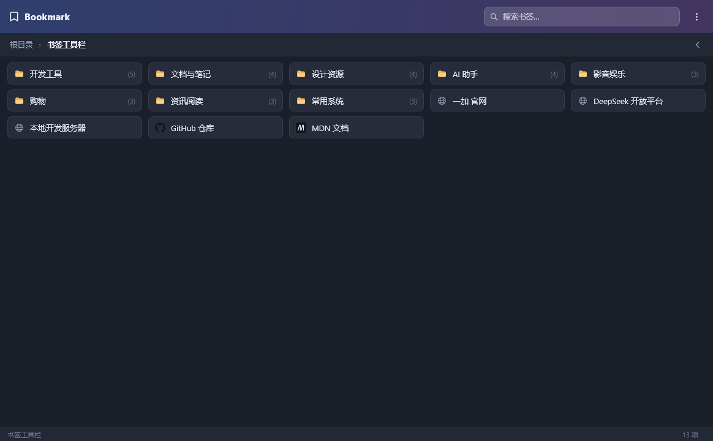

# Bookmark - 简洁书签

一个轻量的 Firefox 书签管理器。点击工具栏图标直接打开独立窗口，多列自适应布局，窗口可自由调整大小，**永远不出现滚动条**。



## 特点

- **独立窗口打开** —— 点图标开窗，再点聚焦已有窗口，不重复开。窗口可拖到任意大小（480×360 ~ 1600×1200），尺寸会被记住
- **无滚动条** —— 滚轮 / 触控板 / 方向键照常滚动，右下角提示「下方还有 N 项」，不靠滚动条也能知道还有内容
- **多列自适应** —— 默认按窗口宽度铺满，窗口越宽列数越多；也可在设置里锁定 1/2/3 列
- **面包屑导航** —— 显示完整路径，点击跳转；拖书签到面包屑即可移入上级
- **实时搜索** —— 输入即搜，匹配书签名称与网址
- **右键菜单** —— 打开、编辑、复制链接、移到上级文件夹、删除
- **拖拽排序** —— 拖动卡片重排，拖到文件夹上移入
- **跟随系统主题** —— 自动 / 亮色 / 暗色
- **图标缓存** —— 站点图标本地缓存 7 天，失败降级为灰色地球，不反复请求

## 安装

### 从 Release 安装

1. 到 [Releases](../../releases) 下载最新的 `.xpi`
2. Firefox 地址栏输入 `about:debugging#/runtime/this-firefox`
3. 点「临时载入附加组件…」，选择下载的 `.xpi`

> 未签名的扩展在正式版 Firefox 里只能临时载入，重启浏览器后需要重新载入。

### 从源码载入

```bash
git clone https://github.com/<你的用户名>/<仓库名>.git
```

然后 `about:debugging#/runtime/this-firefox` →「临时载入附加组件…」→ 选择仓库里的 `manifest.json`。

载入后 Firefox 会把它收在扩展面板里。想直接点图标打开：点工具栏右侧的扩展图标（拼图形状）→ 找到 **Bookmark** → 齿轮 → 「固定到工具栏」。

## 使用

| 操作 | 说明 |
| --- | --- |
| 点工具栏图标 | 打开 / 聚焦书签窗口 |
| `/` 或 `Ctrl+F` | 聚焦搜索框 |
| `Esc` | 依次关闭对话框 / 菜单 / 清空搜索 |
| `Alt+←` 或 `Backspace` | 返回上级文件夹 |
| 菜单 → 窗口尺寸… | 精确设置窗口大小，或点预设 |
| 右键书签/文件夹 | 编辑、复制链接、删除、移到上级 |

窗口大小也可以直接拖边框，松手后自动记住。

## 开发

环境：Firefox 140+、Node.js 18+、Python 3.8+（仅打包用）。

```bash
# 语法检查
node --check popup.js
node --check options.js
node --check background.js
node --check boot.js

# 按 AMO 规则检查（需先 npm i -g web-ext）
web-ext lint --source-dir .

# 打包
python scripts/pack.py
```

打包产物输出到 `dist/bookmark-<version>.xpi`。

> **不要用 PowerShell 的 `Compress-Archive` 打包。** 它在 Windows 上会把 zip 条目路径写成反斜杠
> （`icons\icon-16.png`），AMO 会拒绝并报 `Invalid file name in archive`。
> `scripts/pack.py` 已强制使用正斜杠并做了自检。

### 目录结构

```
.
├── manifest.json        # MV2 清单（无 default_popup，点击走 onClicked）
├── background.js        # 开窗、窗口复用、尺寸记忆
├── boot.js              # 首帧同步应用上次主题，避免闪白
├── popup.html/css/js    # 窗口主体（书签界面）
├── options.html/css/js  # 设置页
├── icons/               # 16~256 图标（代码生成，非位图缩放）
├── screenshots/         # 商店展示截图
└── scripts/pack.py      # 打包脚本
```

## 权限说明

| 权限 | 用途 |
| --- | --- |
| `bookmarks` | 读写书签，全部功能依赖它 |
| `tabs` | 在新标签页打开书签 |
| `storage` | 保存设置、窗口尺寸、图标缓存 |

不请求 `clipboardWrite`（复制链接用 `navigator.clipboard`，失败回退 `execCommand`）。
**不向任何服务器发送数据**，无远程请求。书签的站点图标由浏览器直连该网站自身的 `/favicon.ico`，不经过第三方。

## 已知限制

- `manifest_version: 2`，Firefox 140+ 支持
- 窗口尺寸上限 1600 × 1200，超出屏幕时由 Firefox 自动收进工作区
- 仅支持桌面 Firefox。Android 版不支持 `windows.create({ type: 'popup' })`，本扩展也未声明 `gecko_android`

## 许可

[MIT](LICENSE)
